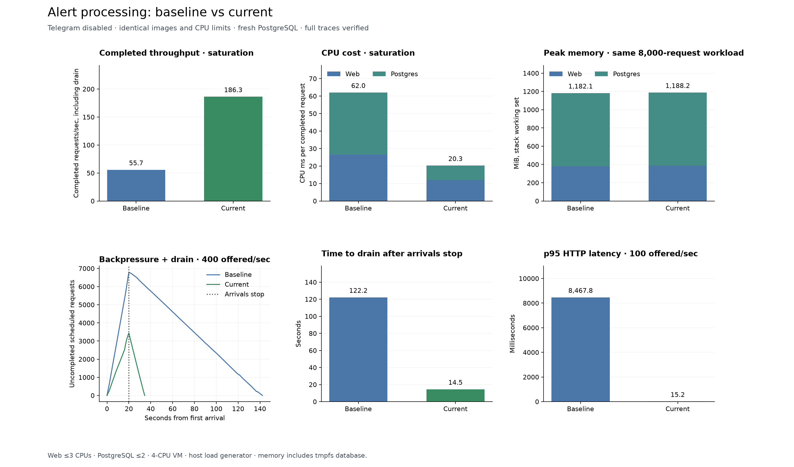
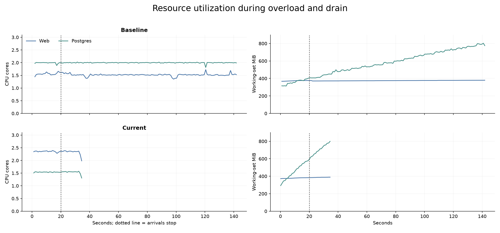

# Alert-processing benchmark

Baseline and current application.

_Note: telegram container was disabled in both runs._

| Measurement | Baseline | Current |
|---|---:|---:|
| Completed requests/sec | 55.71 | 186.35 |
| CPU ms/completed request | 62.04 | 20.26 |
| Peak working-set MiB | 1,182.11 | 1,188.23 |
| p95 latency at 100/sec (ms) | 8,467.79 | 15.21 |
| Backlog after overload offer | 6,792.00 | 3,438.00 |
| Drain time (seconds) | 122.23 | 14.53 |
| Successful completions/sec during drain | 55.57 | 236.60 |

## Method

Compared `29e7f82de1a3a97ef812615b0c3dfd822da81154` with `c9cb20cf8b2e040540b65277bc89d6a23e720b8c` using the same runtime images, four Gunicorn workers with four threads each, and a fresh PostgreSQL database. Limits: web three CPUs and PostgreSQL two CPUs. The load generator runs on the host.
Each run receives 125 warmup events, then 20-second probes at 100/sec, 400/sec, and 128-client saturation. Saturation starts after 10,125 completed events. The overload offer contains 8,000 unique requests.
Every successful response is matched to persisted alerts, distinct groups, completed full traces and trace steps. CPU includes app and PostgreSQL. Memory is working-set usage and includes tmpfs database storage; memory is compared at the same request count.

Measurements and request timelines are in measurements.json. Resource timeline charts require the resource logs generated by a benchmark run. Validation results are in validation.json.
